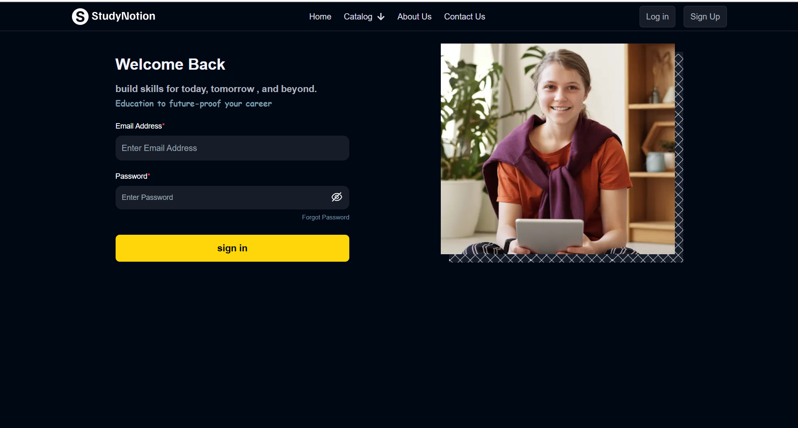
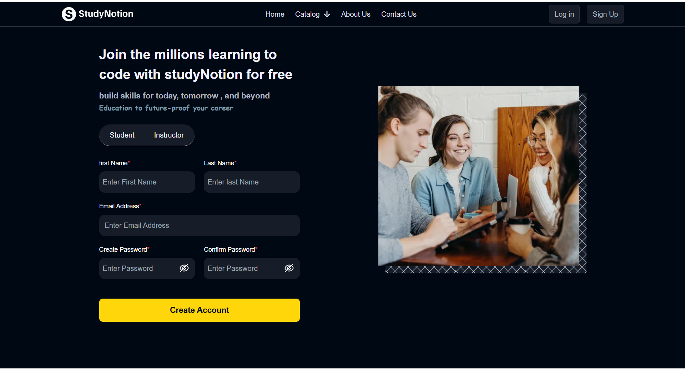
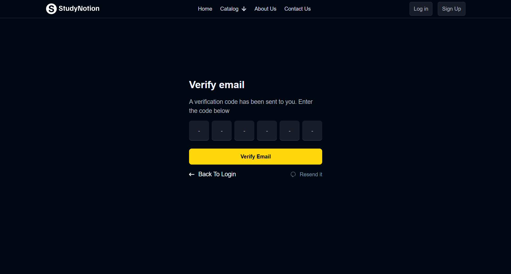
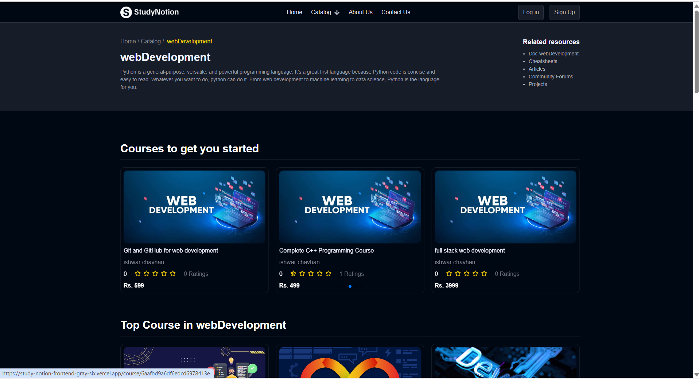
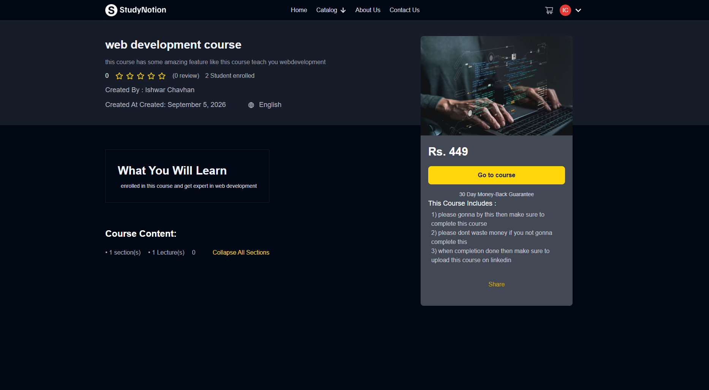
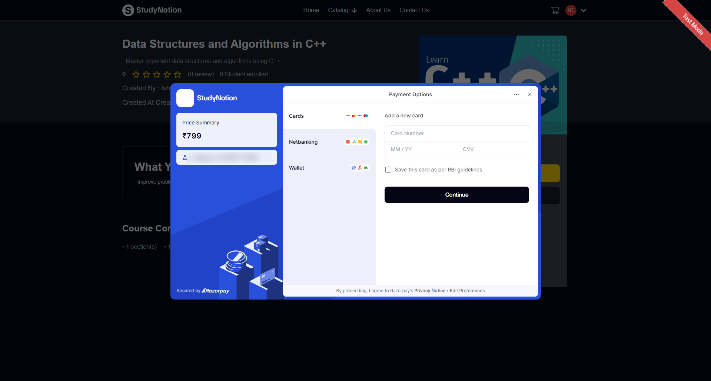
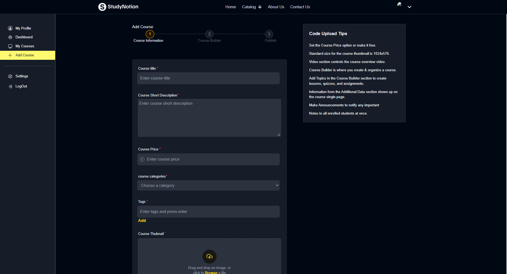
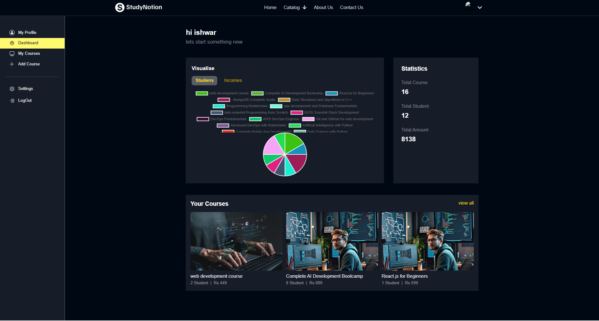

# StudyNotion - EdTech Platform (MERN)

A full-stack ed-tech platform where **instructors create and sell video courses** and **students buy them with Razorpay, watch lectures and track their progress**.

**Live demo:** https://study-notion-frontend-gray-six.vercel.app
**Backend API:** https://studynotion-backend-svaa.onrender.com/api/v1

> The backend runs on Render's free tier, so the first request after a period of inactivity can take 30-60 seconds to wake up.

---

## Screenshots

| Home | Login |
|------|-------|
|  |  |

| Signup (Student / Instructor) | Email OTP Verification |
|-------------------------------|------------------------|
|  |  |

| Catalog | Course Details |
|---------|----------------|
|  |  |

| Payment (Razorpay test mode) | Course Builder |
|------------------------------|----------------|
|  |  |

| Instructor Dashboard |
|----------------------|
|  |

---

## Features

**Student**
- Sign up with email OTP verification, log in, reset forgotten password by email
- Browse courses by category, view details, ratings and reviews
- Add to cart and pay securely with Razorpay
- Watch purchased courses with a section/lecture sidebar
- Mark lectures complete and see a progress bar
- Rate and review courses, edit profile and profile picture

**Instructor**
- Create courses with a 3-step builder (info, sections and video lectures, publish)
- Edit or delete courses, sections and lectures; save as draft or publish
- Dashboard with charts for students enrolled and income

**Admin**
- Create and manage course categories

**General**
- Role-based access (Student / Instructor / Admin) on both frontend and backend
- JWT authentication, bcrypt password hashing
- Image and video uploads to Cloudinary
- Responsive UI built with Tailwind CSS

---

## Tech Stack

| Layer | Technologies |
|-------|--------------|
| Frontend | React 18, Redux Toolkit, React Router, Tailwind CSS, Axios, React Hook Form, Chart.js, Swiper, Video-React |
| Backend | Node.js, Express.js, MongoDB, Mongoose, JWT, bcrypt, Nodemailer |
| Services | Razorpay (payments), Cloudinary (media), MongoDB Atlas (database) |
| Deployment | Vercel (frontend), Render (backend) |

---

## Architecture

```
React app (Vercel)
      |  Axios -> REACT_APP_BASE_URL
      v
Express API (Render)  -- auth / role middleware
      |         |            |            |
   MongoDB   Cloudinary    Razorpay    Nodemailer
```

**Data model:** `Course -> Section[] -> SubSection[]` (video), plus `User`, `Profile`, `Category`, `RatingAndReview`, `CourseProgress`, `OTP`.

**Payment flow:** server creates order -> Razorpay checkout in browser -> server verifies HMAC-SHA256 signature -> student is enrolled and a confirmation email is sent.

---

## Project Structure

```
StudyNotion/
├── src/              # React frontend
│   ├── components/
│   ├── pages/
│   ├── services/     # API connector and operations
│   ├── slices/       # Redux Toolkit slices
│   └── reducer/
├── public/
├── MegaProject/      # Express backend
├── .env.example
├── tailwind.config.js
└── vercel.json
```

---

## Getting Started

### Prerequisites
- Node.js 16+
- A MongoDB database (Atlas or local)
- Cloudinary, Razorpay (test mode) and an email account for SMTP

### 1. Clone and install

```bash
git clone https://github.com/ishwar-chavhan/StudyNotion.git
cd StudyNotion
npm install
cd MegaProject && npm install && cd ..
```

### 2. Environment variables

**Frontend** - create `.env` in the root (see `.env.example`):

```env
REACT_APP_BASE_URL=http://localhost:4000/api/v1
REACT_APP_RAZORPAY_KEY=your_razorpay_key_id
```

**Backend** - create `.env` inside `MegaProject/`:

```env
PORT=4000
MONGODB_URL=your_mongodb_connection_string
JWT_SECRET=your_jwt_secret
MAIL_HOST=smtp.gmail.com
MAIL_USER=your_email
MAIL_PASS=your_app_password
CLOUD_NAME=your_cloudinary_name
API_KEY=your_cloudinary_key
API_SECRET=your_cloudinary_secret
FOLDER_NAME=StudyNotion
RAZORPAY_KEY=your_razorpay_key_id
RAZORPAY_SECRET=your_razorpay_secret
```

### 3. Run

```bash
npm run dev      # starts frontend and backend together
```

Frontend: http://localhost:3000
Backend: http://localhost:4000

---

## Deployment

- **Frontend:** Vercel. `vercel.json` rewrites all routes to `index.html` so page refresh works with React Router. Set `REACT_APP_BASE_URL` and `REACT_APP_RAZORPAY_KEY` in the Vercel project settings, then redeploy.
- **Backend:** Render web service. Add all backend environment variables in the Render dashboard and allow the Vercel domain in CORS.

---

## What I Learned

- Designing role-based access with JWT middleware
- Integrating Razorpay and verifying payments on the server
- Modelling nested data (course, section, lecture) in MongoDB
- Managing global state with Redux Toolkit
- Deploying a split frontend/backend app and fixing CORS and SPA routing issues

## Future Improvements

- Razorpay webhooks, refresh tokens, rate limiting
- Search and pagination, wishlist, course certificates
- Automated tests, and migrating from Create React App to Vite

---

## Author

**Ishwar Chavhan** - [GitHub](https://github.com/ishwar-chavhan)
